

   <b>English</b> &nbsp;·&nbsp; <a href="https://github.com/ramongime/ramongime/blob/main/README.pt-BR.md"> Português</a>

<a href="https://ramongimenes.dev.br/">
  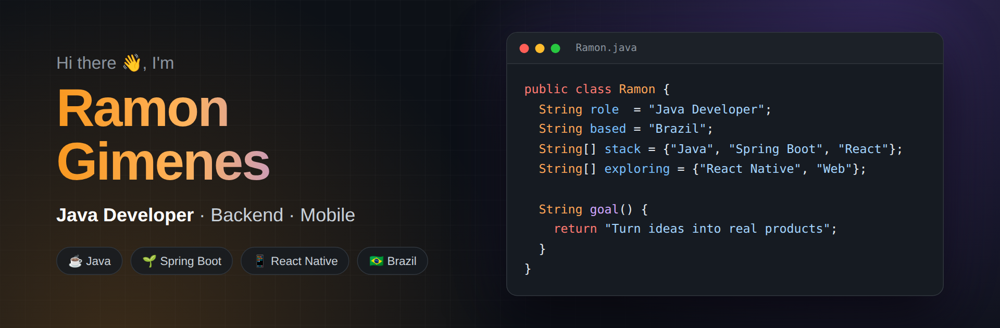
</a>

 

 

## 👨‍💻 About me

**Senior Java developer** from Brazil with **9 years of experience** building backends with
**Java and Spring Boot**. I also build mobile apps with **React Native**, and I like solutions
that are simple, useful and easy to use: code matters, but the solved problem is what counts.

- ☕ 9 years building backends with **Java** and **Spring Boot**
- 🧩 Microservices, relational and NoSQL databases, messaging and cloud
- 🚀 Creator of [**Ciclos**](#ciclos), [**OrçaFácil**](#orcafacil), [**IPlayerTV**](#iplayertv) and [**Fokus**](#fokus): Java APIs, mobile, desktop and TV apps
- 💡 Simple, useful and easy to use: that's the goal

 

## 🧰 Tech stack

<table>
  <tr>
    <td align="center" width="120"><b>Backend</b></td>
    <td>
      
      
      
      
       Java · Spring Boot · Hibernate · Quarkus · REST APIs · LangChain4j
    </td>
  </tr>
  <tr>
    <td align="center"><b>Data</b></td>
    <td>
      
      
      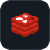
      
       SQL · PostgreSQL · MongoDB · Redis · Kafka
    </td>
  </tr>
  <tr>
    <td align="center"><b>Frontend</b></td>
    <td>
      
      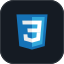
      
      
      
      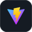
       HTML · CSS · JavaScript · TypeScript · React · Vite
    </td>
  </tr>
  <tr>
    <td align="center"><b>Mobile</b></td>
    <td>
      
      
       React Native · Expo
    </td>
  </tr>
  <tr>
    <td align="center"><b>Desktop &amp; TV</b></td>
    <td>
      
       Electron · Android TV · Samsung Tizen
    </td>
  </tr>
  <tr>
    <td align="center"><b>Infra</b></td>
    <td>
      
      
      
       Docker · Kubernetes · AWS · CI/CD
    </td>
  </tr>
  <tr>
    <td align="center"><b>Tools</b></td>
    <td>
      
      
      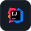
      
       Git · GitHub · IntelliJ IDEA · VS Code
    </td>
  </tr>
</table>

 

## 🚀 Featured projects

Products I designed and built end to end, from the **Java API** to the app on your phone, your computer and your TV.

<table>
  <tr>
    <td align="center" width="25%">
      <a href="#ciclos">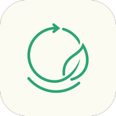</a> 
      <a href="#ciclos"><b>Ciclos</b></a> 
      Recurring tasks, habits and routines 
      📱 React Native · ☕ Java API
    </td>
    <td align="center" width="25%">
      <a href="#orcafacil">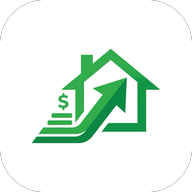</a> 
      <a href="#orcafacil"><b>OrçaFácil</b></a> 
      AI-powered quotes for service providers 
      📱 React Native · ☕ Java API · 🤖 Gemini
    </td>
    <td align="center" width="25%">
       
      <a href="#iplayertv"><b>IPlayerTV</b></a> 
      IPTV player for desktop, mobile and TV 
      🟦 TypeScript · ⚛️ Electron · 📺 Tizen
    </td>
    <td align="center" width="25%">
      <a href="#fokus">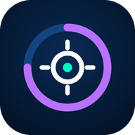</a> 
      <a href="#fokus"><b>Fokus</b></a> 
      Pomodoro timer + task list 
      📱 React Native · 🧪 Jest · ⚙️ CI
    </td>
  </tr>
</table>

 

<a href="https://ciclosapp.com.br/">
  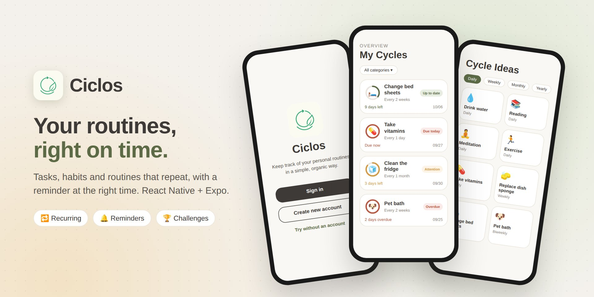
</a>

### ♻️ Ciclos

**Everything that repeats, each on its own schedule.** A full-stack app to keep track of recurring tasks,
habits and routines: changing the bed sheets every two weeks, taking vitamins every day, servicing the car
every year. A **React Native** app backed by my own **Java 25 + Spring Boot** API.

<table>
  <tr>
    <td width="50%" valign="top">

**📱 App** · React Native · Expo

- 🔁 Cycles from hours to years, renewed with one tap
- 🏆 Challenges with invite codes, a consistency ranking and a global challenge every month
- 🎖️ Achievements, discipline levels and shareable streak cards
- 👤 Guest mode: use it without an account, sync when you sign up
- 🌎 Portuguese, English and Spanish, light and dark themes

</td>
    <td width="50%" valign="top">

**☕ API** · Java 25 · Spring Boot · PostgreSQL

- 🧭 Ports and adapters, organized by vertical contexts
- 🔔 A scheduler checks the cycles every minute and sends push reminders
- 🔐 JWT with refresh tokens, Google sign-in and rate limiting
- 💎 Premium plan with RevenueCat, mirrored limits in app and API
- 🧪 Testcontainers, JaCoCo with a 95% coverage gate, Flyway migrations

</td>
  </tr>
</table>

 

<a href="https://www.fzsoftware.com.br/downloads/orcafacil/">
  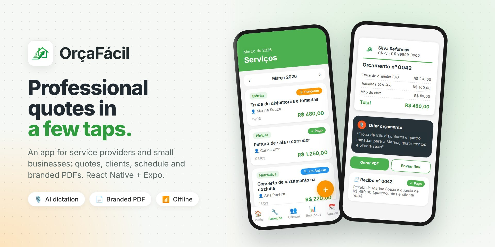
</a>

### 🏠 OrçaFácil

**Professional quotes in a few taps.** A platform for independent service providers and small businesses
in Brazil: say the quote out loud, the AI fills in the form, and the client gets a branded PDF or a link.
A **React Native** app, a **Java 25 + Spring Boot 4** API with **Gemini**, and a **React** landing page.

<table>
  <tr>
    <td width="50%" valign="top">

**📱 App** · React Native · Expo

- 🎙️ Voice dictation: speech is recognized on the device, Gemini fills in the quote
- 📄 Quotes, receipts and work orders as PDFs with the provider's own logo
- 🔗 A public link so the client can see the quote without the app
- 📶 Offline first: a serialized sync queue that remaps temporary IDs
- 👥 Clients, catalog, schedule, monthly reports and revenue goals

</td>
    <td width="50%" valign="top">

**☕ API** · Java 25 · Spring Boot 4 · PostgreSQL

- 🤖 LangChain4j + Google Gemini: voice to quote and price suggestions
- 🧭 Hexagonal architecture guarded by 13 ArchUnit rules
- 🔐 JWT with refresh tokens, password reset by email, IP rate limiting
- 🔗 Server-rendered public quote page, no login and no JavaScript
- 🧪 Testcontainers and a 90% JaCoCo gate, Flyway, Docker

</td>
  </tr>
</table>

 

<a href="https://www.fzsoftware.com.br/downloads/iplayertv/">
  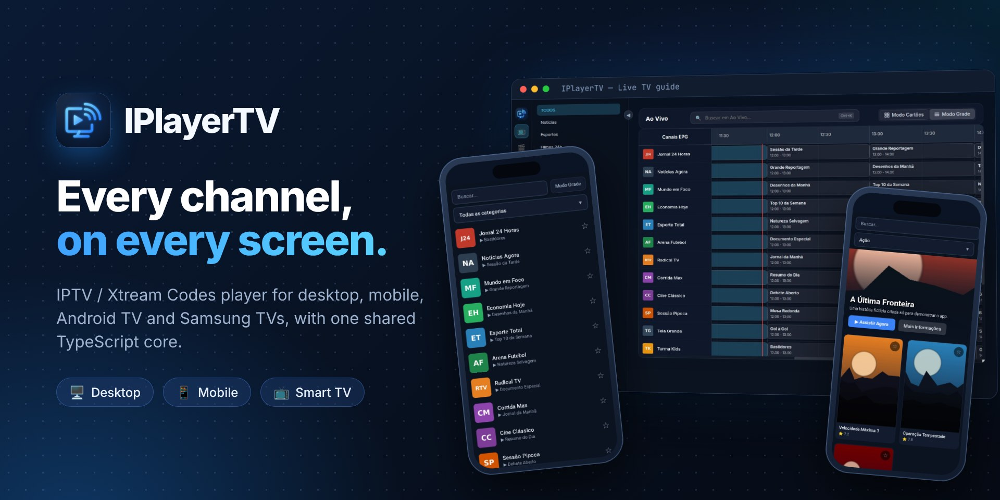
</a>

### 📺 IPlayerTV

**Every channel, on every screen.** An IPTV / Xtream Codes player for the computer, the phone, Android TV and
Samsung Smart TVs, built as a monorepo where every app shares one **TypeScript** core: domain, Xtream client,
M3U and XMLTV parsers, and i18n.

<table>
  <tr>
    <td align="center" width="25%">🖥️ <b>Desktop</b> Electron · React · SQLite Windows, macOS, Linux</td>
    <td align="center" width="25%">📱 <b>Mobile</b> Expo · native player iOS and Android</td>
    <td align="center" width="25%">🤖 <b>Android TV</b> Remote control focus navigation</td>
    <td align="center" width="25%">📺 <b>Samsung TV</b> Tizen · native AVPlay IndexedDB cache</td>
  </tr>
</table>

- 📅 TV guide (EPG) in grid mode, catch-up and XMLTV import
- 🪟 Multi-view: up to 4 live channels at the same time
- ⬇️ Downloads to watch offline and scheduled recordings from the guide
- 👨‍👩‍👧 Profiles, PIN parental control and Chromecast
- ⚡ Each platform declares what its player decodes, so movies start without on-the-fly transcoding
- 🧱 Import boundaries enforced in CI with dependency-cruiser

 

<a href="https://github.com/ramongime/Fokus">
  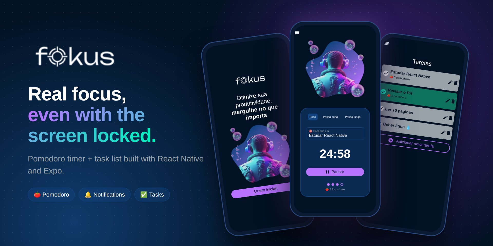
</a>

### 🍅 Fokus

**Real focus, even with the screen locked.** A minimalist Pomodoro timer and task list: lock the screen,
put the phone away, and Fokus lets you know when time is up. The code is public on GitHub.

- ⏱️ Keeps counting with the screen locked, then notifies and vibrates at the end of each cycle
- 🔁 Chains focus and breaks on its own, with a long break every few sessions
- 🎯 Links a task to the focus session and counts pomodoros per task
- 📊 Weekly history with a chart, focused time and day streak
- 🧪 157 tests on the business logic, zero lint warnings and CI on every push

 

## 🐍 Contribution activity

<picture>
  <source media="(prefers-color-scheme: dark)" srcset="https://raw.githubusercontent.com/ramongime/ramongime/output/github-snake-dark.svg">
  <source media="(prefers-color-scheme: light)" srcset="https://raw.githubusercontent.com/ramongime/ramongime/output/github-snake.svg">
  
</picture>

 

## 🤝 Let's connect

  

**Thanks for stopping by!** Feel free to explore my repositories and follow my journey 🚀

