

  <a href="https://github.com/ramongime"> English</a> &nbsp;·&nbsp;  <b>Português</b>

<a href="https://ramongimenes.dev.br/">
  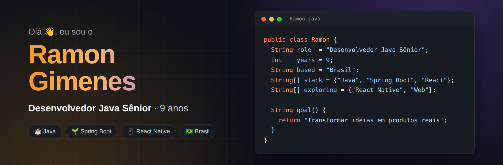
</a>

 

  

 

## 👨‍💻 Sobre mim

**Desenvolvedor Java sênior**, brasileiro, com **9 anos de experiência** construindo backends com
**Java e Spring Boot**. Também crio apps mobile com **React Native**, e gosto de soluções simples,
úteis e fáceis de usar: o código importa, mas o que vale é o problema resolvido.

- ☕ 9 anos construindo backends com **Java** e **Spring Boot**
- 🧩 Microserviços, bancos relacionais e NoSQL, mensageria e nuvem
- 🚀 Criador do [**Ciclos**](#ciclos), do [**OrçaFácil**](#orcafacil), do [**IPlayerTV**](#iplayertv) e do [**Fokus**](#fokus): APIs em Java e apps para celular, computador e TV
- 💡 Simples, útil e fácil de usar: esse é o objetivo

 

## 🧰 Tecnologias

<table>
  <tr>
    <td align="center" width="120"><b>Backend</b></td>
    <td>
      
      
      
      
       Java · Spring Boot · Hibernate · Quarkus · REST APIs · LangChain4j
    </td>
  </tr>
  <tr>
    <td align="center"><b>Dados</b></td>
    <td>
      
      
      
      
       SQL · PostgreSQL · MongoDB · Redis · Kafka
    </td>
  </tr>
  <tr>
    <td align="center"><b>Frontend</b></td>
    <td>
      
      
      
      
      
      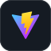
       HTML · CSS · JavaScript · TypeScript · React · Vite
    </td>
  </tr>
  <tr>
    <td align="center"><b>Mobile</b></td>
    <td>
      
      
       React Native · Expo
    </td>
  </tr>
  <tr>
    <td align="center"><b>Desktop e TV</b></td>
    <td>
      
       Electron · Android TV · Samsung Tizen
    </td>
  </tr>
  <tr>
    <td align="center"><b>Arquitetura</b></td>
    <td>
      
      
      
      
      
      
       Microsserviços · Hexagonal · Clean Architecture · DDD · CQRS · TDD
    </td>
  </tr>
  <tr>
    <td align="center"><b>Infra</b></td>
    <td>
      
      
      
       Docker · Kubernetes · AWS · CI/CD
    </td>
  </tr>
  <tr>
    <td align="center"><b>Ferramentas</b></td>
    <td>
      
      
      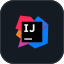
      
       Git · GitHub · IntelliJ IDEA · VS Code
    </td>
  </tr>
</table>

 

## 🚀 Projetos em destaque

Produtos que eu desenhei e construí de ponta a ponta: a **API em Java**, o app no seu celular, no seu computador e na sua TV, e a landing page.

<table>
  <tr>
    <td align="center" width="25%">
      <a href="#ciclos">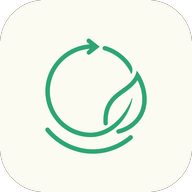</a> 
      <a href="#ciclos"><b>Ciclos</b></a> 
      Tarefas, hábitos e rotinas recorrentes 
      📱 React Native · ☕ API Java
    </td>
    <td align="center" width="25%">
      <a href="#orcafacil">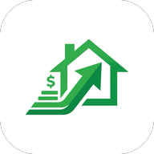</a> 
      <a href="#orcafacil"><b>OrçaFácil</b></a> 
      Orçamentos com IA para prestadores de serviço 
      📱 React Native · ☕ API Java · 🤖 Gemini
    </td>
    <td align="center" width="25%">
       
      <a href="#iplayertv"><b>IPlayerTV</b></a> 
      Player IPTV para computador, celular e TV 
      🟦 TypeScript · ⚛️ Electron · 📺 Tizen
    </td>
    <td align="center" width="25%">
      <a href="#fokus">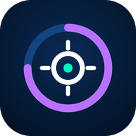</a> 
      <a href="#fokus"><b>Fokus</b></a> 
      Timer Pomodoro + lista de tarefas 
      📱 React Native · 🧪 Jest · ⚙️ CI
    </td>
  </tr>
</table>

 

<a href="https://ciclosapp.com.br/">
  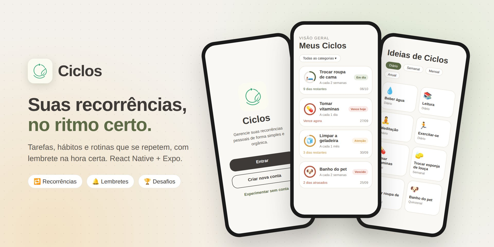
</a>

### ♻️ Ciclos

**Tudo o que se repete, cada coisa no seu intervalo.** Um app full stack para acompanhar tarefas, hábitos e
rotinas recorrentes: trocar a roupa de cama a cada duas semanas, tomar vitamina todo dia, revisar o carro todo
ano. Um app em **React Native** com a minha própria API em **Java 25 + Spring Boot**.

<table>
  <tr>
    <td width="50%" valign="top">

**📱 App** · React Native · Expo

- 🔁 Ciclos de horas a anos, renovados com um toque
- 🏆 Desafios com código de convite, ranking de constância e um desafio global todo mês
- 🎖️ Conquistas, níveis de disciplina e cards de sequência para compartilhar
- 👤 Modo visitante: use sem conta e leve os dados quando se cadastrar
- 🌎 Português, inglês e espanhol, tema claro e escuro

</td>
    <td width="50%" valign="top">

**☕ API** · Java 25 · Spring Boot · PostgreSQL

- 🧭 Ports and adapters, organizada por contextos verticais
- 🔔 Um agendador confere os ciclos a cada minuto e envia os lembretes push
- 🔐 JWT com refresh token, login com Google e rate limiting
- 💎 Plano premium com RevenueCat, com os mesmos limites no app e na API
- 🧪 Testcontainers, JaCoCo com cobertura mínima de 95% e migrations com Flyway

</td>
  </tr>
</table>

 

<a href="https://www.fzsoftware.com.br/downloads/orcafacil/">
  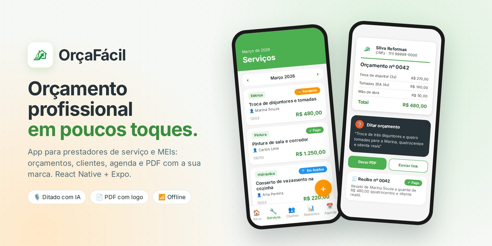
</a>

### 🏠 OrçaFácil

**Orçamento profissional em poucos toques.** Uma plataforma para prestadores de serviço autônomos e MEIs:
você fala o orçamento, a IA preenche o formulário e o cliente recebe um PDF com a sua marca ou um link.
Um app em **React Native**, uma API em **Java 25 + Spring Boot 4** com **Gemini** e uma landing page em **React**.

<table>
  <tr>
    <td width="50%" valign="top">

**📱 App** · React Native · Expo

- 🎙️ Ditado por voz: a fala é reconhecida no aparelho e o Gemini preenche o orçamento
- 📄 Orçamento, recibo e ordem de serviço em PDF com o logo do prestador
- 🔗 Link público para o cliente ver o orçamento sem precisar do app
- 📶 Offline first: fila de sincronização serializada que remapeia os IDs temporários
- 👥 Clientes, catálogo, agenda, relatório mensal e metas de faturamento

</td>
    <td width="50%" valign="top">

**☕ API** · Java 25 · Spring Boot 4 · PostgreSQL

- 🤖 LangChain4j + Google Gemini: voz vira orçamento e a IA sugere quanto cobrar
- 🧭 Arquitetura hexagonal protegida por 13 regras do ArchUnit
- 🔐 JWT com refresh token, troca de senha por e-mail e rate limiting por IP
- 🔗 Página pública do orçamento gerada no servidor, sem login e sem JavaScript
- 🧪 Testcontainers e gate de 90% no JaCoCo, Flyway e Docker

</td>
  </tr>
</table>

 

<a href="https://www.fzsoftware.com.br/downloads/iplayertv/">
  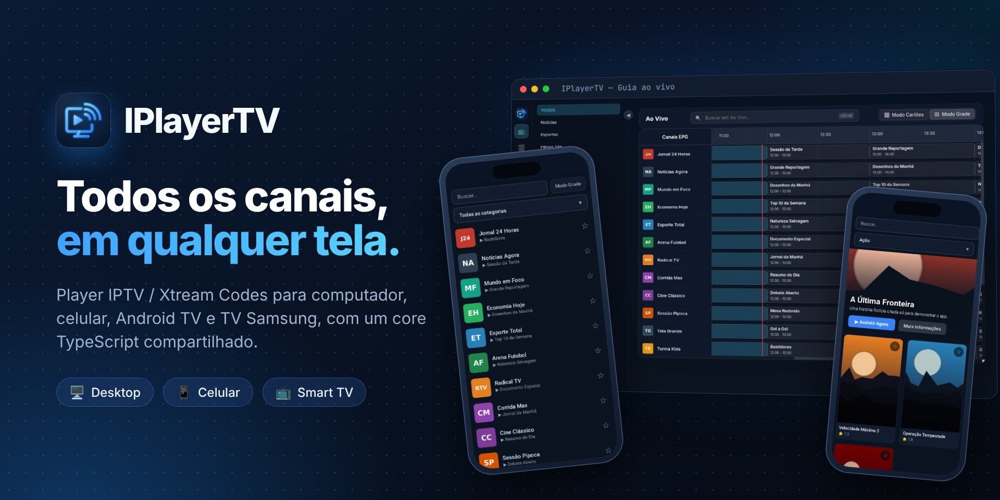
</a>

### 📺 IPlayerTV

**Todos os canais, em qualquer tela.** Um player IPTV / Xtream Codes para computador, celular, Android TV e
Smart TVs Samsung, feito num monorepo em que todos os apps usam o mesmo core em **TypeScript**: domínio,
cliente Xtream, parsers de M3U e XMLTV e i18n.

<table>
  <tr>
    <td align="center" width="25%">🖥️ <b>Desktop</b> Electron · React · SQLite Windows, macOS e Linux</td>
    <td align="center" width="25%">📱 <b>Celular</b> Expo · player nativo iOS e Android</td>
    <td align="center" width="25%">🤖 <b>Android TV</b> Navegação por foco no controle remoto</td>
    <td align="center" width="25%">📺 <b>TV Samsung</b> Tizen · AVPlay nativo cache no IndexedDB</td>
  </tr>
</table>

- 📅 Guia de programação (EPG) em grade, catch-up e importação de XMLTV
- 🪟 Multi-view: até 4 canais ao vivo ao mesmo tempo
- ⬇️ Downloads para assistir offline e gravações agendadas pelo guia
- 👨‍👩‍👧 Perfis, controle parental por PIN e Chromecast
- ⚡ Cada plataforma declara o que o seu player decodifica, e o filme começa sem conversão no servidor
- 🧱 Fronteiras de import verificadas no CI com dependency-cruiser

 

<a href="https://github.com/ramongime/Fokus">
  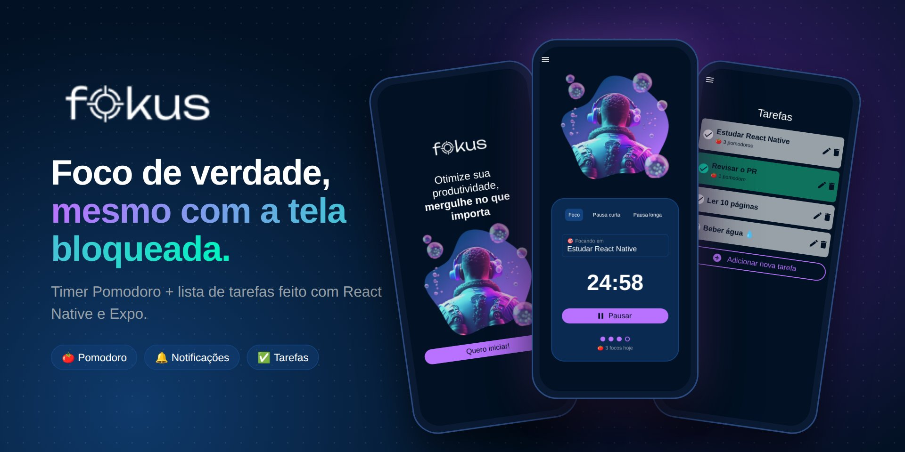
</a>

### 🍅 Fokus

**Foco de verdade, mesmo com a tela bloqueada.** Um timer Pomodoro com lista de tarefas, minimalista:
bloqueie a tela, guarde o celular e o Fokus te avisa quando o tempo acabar. O código é público no GitHub.

- ⏱️ Continua contando com a tela bloqueada e avisa (e vibra) no fim de cada ciclo
- 🔁 Emenda foco e pausas sozinho, com uma pausa longa a cada alguns focos
- 🎯 Vincula uma tarefa ao foco e conta os pomodoros de cada tarefa
- 📊 Histórico da semana com gráfico, tempo focado e sequência de dias
- 🧪 157 testes nas regras de negócio, lint sem avisos e CI a cada push

 

### 🧩 Outros projetos

<table>
  <tr>
    <td width="50%" valign="top">
      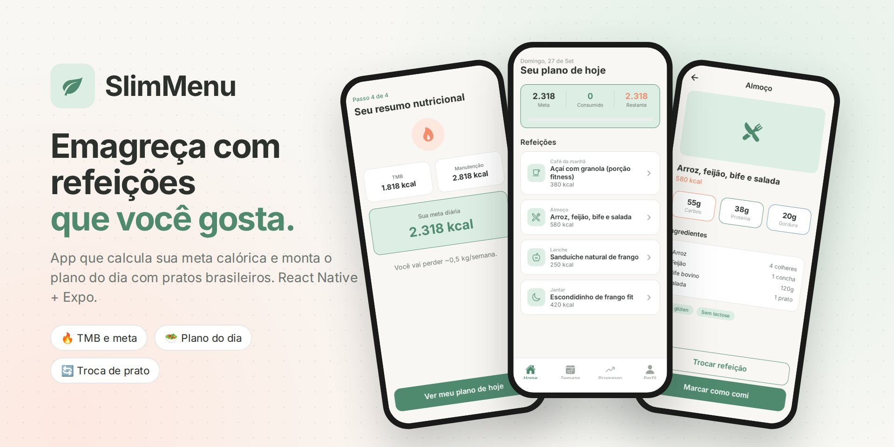
       
      <b>🥗 SlimMenu</b> 
      App de emagrecimento que calcula a sua meta calórica (Mifflin-St Jeor) e monta o plano do dia com
      refeições brasileiras, com macros, troca de prato e progresso de peso. React Native, Expo Router e Zustand.
    </td>
    <td width="50%" valign="top">
      <a href="https://ramongimenes.dev.br/">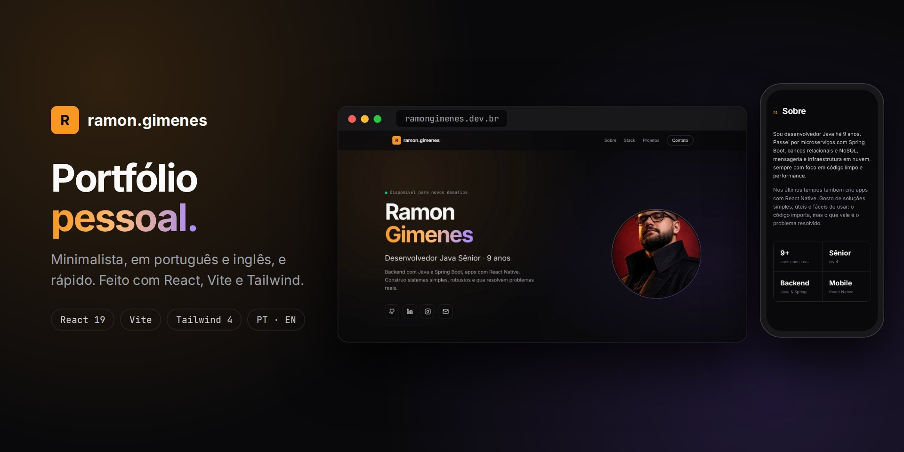</a>
       
      <a href="https://ramongimenes.dev.br/"><b>🌐 ramongimenes.dev.br</b></a> 
      Meu portfólio pessoal: uma página só, minimalista, em português e inglês, com galeria dos projetos.
      React 19, Vite e Tailwind 4, servido pela Cloudflare.
    </td>
  </tr>
</table>

O Ciclos e o OrçaFácil também têm landing pages próprias, feitas com React, TypeScript e Vite.

 

## 🐍 Atividade de contribuições

<picture>
  <source media="(prefers-color-scheme: dark)" srcset="https://raw.githubusercontent.com/ramongime/ramongime/output/github-snake-dark.svg">
  <source media="(prefers-color-scheme: light)" srcset="https://raw.githubusercontent.com/ramongime/ramongime/output/github-snake.svg">
  
</picture>

 

## ☕ Além do código

<table>
  <tr>
    <td align="center" width="25%">☕ <b>Café</b> Grãos especiais e métodos de extração diferentes</td>
    <td align="center" width="25%">🏎️ <b>Fórmula 1</b> Automobilismo e a precisão das pistas</td>
    <td align="center" width="25%">🏃 <b>Esportes</b> Corpo em movimento, mente afiada</td>
    <td align="center" width="25%">📊 <b>Dados</b> Decisão vem depois da análise</td>
  </tr>
</table>

 

## 🤝 Vamos conversar

  

**Valeu pela visita!** Fique à vontade para explorar meus repositórios e acompanhar minha jornada 🚀

